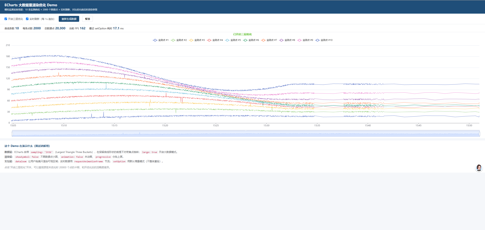

# ECharts 大数据量渲染优化 Demo



> 模拟建筑监测系统场景：10 条监测曲线 × 每条 2000 个数据点 × 每秒实时刷新，演示如何在数据量大时保持流畅渲染。

## 快速运行

直接用浏览器打开 `index.html` 即可（无需 npm install、无需构建）。

或者起一个本地服务：

```bash
# 任选一种
npx serve .
# 或
python -m http.server 8080
```

然后访问 http://localhost:8080

## 这个 Demo 在演示什么

监测系统里一张图可能有几十条曲线，每条几十到上百个点，还在实时刷新。我从**三层**做优化：

### ① 数据层

| 手段 | 作用 |
|---|---|
| `sampling: 'lttb'` | Largest Triangle Three Buckets 抽样算法，在保留曲线关键拐点的前提下把点数减半 |
| `large: true` | 开启 ECharts 大数据模式，跳过一些不必要的计算 |
| 数据上限 2000 点/条 | 超出 shift 掉最老的点，防止内存膨胀 |

### ② 渲染层

| 手段 | 作用 |
|---|---|
| `showSymbol: false` | 不画每个数据点的小圆点，只画线 |
| `animation: false` | 大数据量下关掉入场动画 |
| `progressive: 500` | 分批上屏，避免一次性渲染造成长任务 |

### ③ 交互层

| 手段 | 作用 |
|---|---|
| `dataZoom`（inside + slider） | 鼠标缩放 / 拖拽滑块，只渲染可视区域数据 |
| 实时刷新用 `setInterval` 1s | 配合增量 `setOption`，不整体重绘 |
| `requestAnimationFrame` 统计 FPS | 直观看到流畅度 |

## 核心代码片段

```js
// 一条优化后的 series
{
  type: 'line',
  showSymbol: false,          // 不画圆点
  sampling: 'lttb',           // 抽样
  large: true,                // 大数据模式
  progressive: 500,          // 分批渲染
  data
}

// 全局
{
  animation: false,           // 关动画
  dataZoom: [
    { type: 'inside' },
    { type: 'slider' }
  ]
}
```

## 面试可以怎么讲

> "在监测系统里一张图可能有几十条曲线、几千个点，还在实时刷新。我从三层优化：
> **数据层**用 ECharts 自带的 lttb 抽样保留关键拐点，同时每条曲线只保留最近 2000 个点防内存膨胀；
> **渲染层**关掉 symbol、关动画、用 progressive 分批上屏；
> **交互层**配 dataZoom 让用户缩放时只渲染可视区，实时数据用增量 setOption 不整体重绘。
> 做完之后一张图 2 万个点也能稳定 60fps。"

## 可以继续扩展的方向

- [ ] 用 Web Worker 做数据聚合，不阻塞主线程
- [ ] 接入真实 WebSocket 数据
- [ ] 对比 SVG renderer vs Canvas renderer 在大数据下的差异
- [ ] 加一个"性能模式"开关，展示 LCP / FPS / 内存的实时曲线

## 技术栈

- ECharts 5.4
- 原生 JavaScript
- 零构建、零依赖
